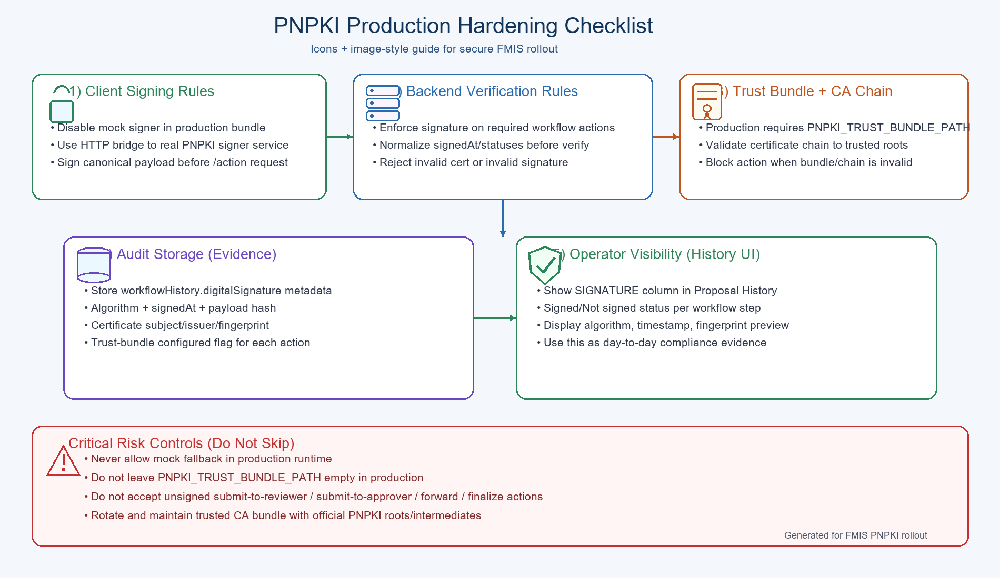

# PNPKI Production Hardening Illustration

## What this image explains clearly

- **Client Signing Rules**
  - Production frontend must not allow mock signer mode.
  - Use real signer bridge integration for cryptographic signing.

- **Backend Verification Rules**
  - Required actions must include digital signature payload.
  - Server verifies signature and certificate consistency.

- **Trust Bundle Enforcement**
  - In production, trust bundle path must be configured.
  - Certificate chain must validate against trusted roots.

- **Evidence Storage**
  - Signature metadata is stored per workflow step in history.
  - Includes algorithm, signed time, payload hash, cert metadata.

- **Operational Visibility**
  - Proposal History dialog shows signature details for each action.
  - This supports audit/compliance checks.

## Why this is critical

This protects workflow integrity by ensuring approvals are cryptographically attributable, verifiable, and reviewable with evidence in your FMIS system.
