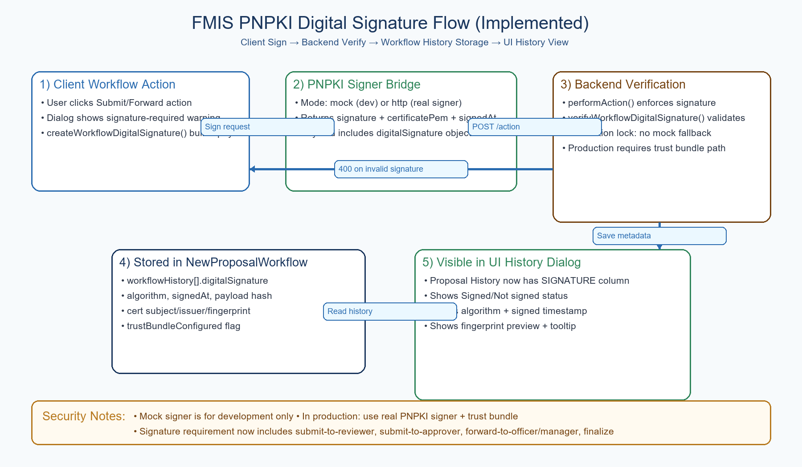

# PNPKI Digital Signature Flow Illustration

## Clear Explanation

1. **Client workflow action starts the signing flow**
   - User clicks workflow actions such as `submit-to-reviewer`.
   - The UI warns that a digital signature is required.
   - The client builds a canonical payload (proposal ID, action, from/to status, signedBy, signedAt).

2. **PNPKI signer bridge signs the payload**
   - In development, signer mode can be `mock`.
   - In real deployment, signer mode should be `http` (external PNPKI signer service/token flow).
   - The response returns `signature`, `certificatePem`, optional chain, and algorithm.

3. **Backend verifies before allowing workflow transition**
   - `performAction` enforces signature for required actions.
   - `verifyWorkflowDigitalSignature` validates payload, certificate, and signature.
   - In production lock mode:
     - mock fallback is disabled,
     - trust bundle is required (`PNPKI_TRUST_BUNDLE_PATH`).

4. **Signature metadata is stored in workflow history**
   - Stored under `workflowHistory[].digitalSignature` in `NewProposalWorkflow`.
   - Includes algorithm, signed timestamp, payload hash, certificate identity fields, and trust-bundle flag.

5. **History UI now shows signature details**
   - Proposal History dialog includes a `SIGNATURE` column.
   - Displays signed/not signed status, algorithm, signed datetime, and fingerprint preview.

## Why this matters

- Adds cryptographic accountability per workflow step.
- Strengthens audit trail and dispute resolution.
- Enables PNPKI-compliant production rollout when real cert chain is configured.
